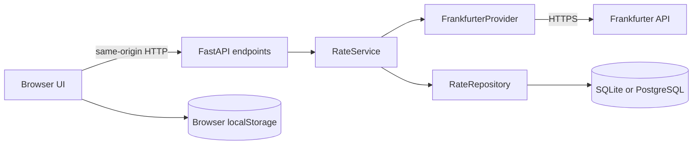
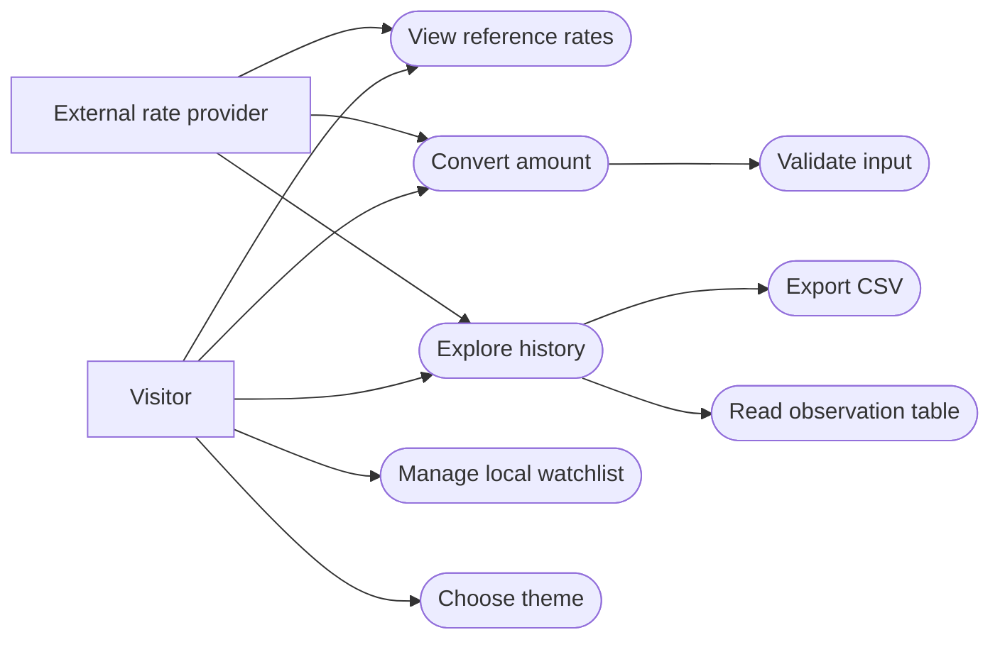
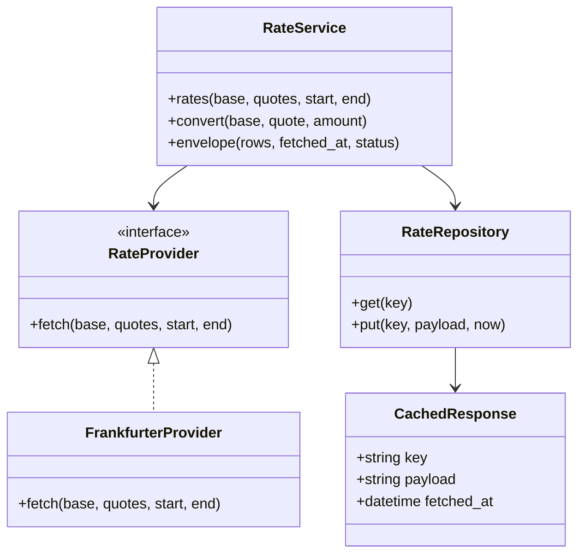
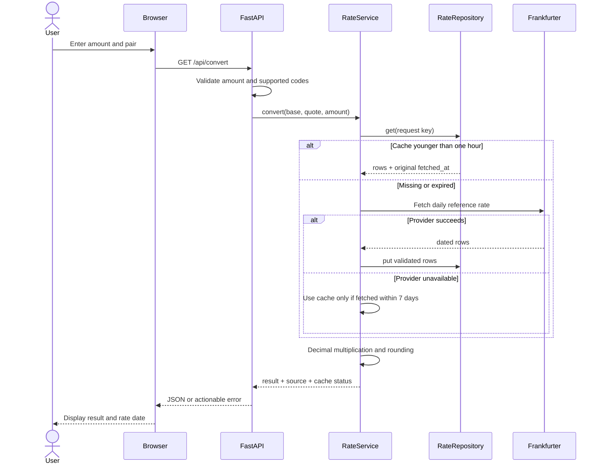
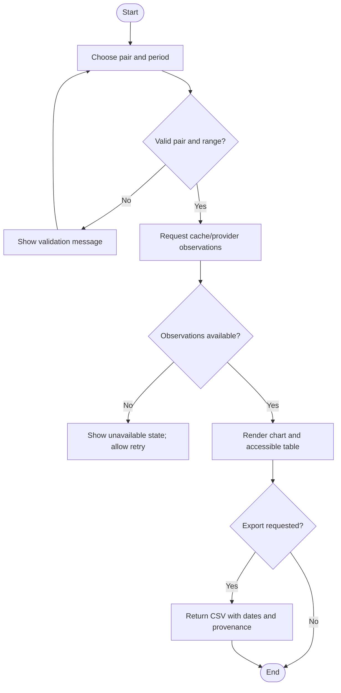
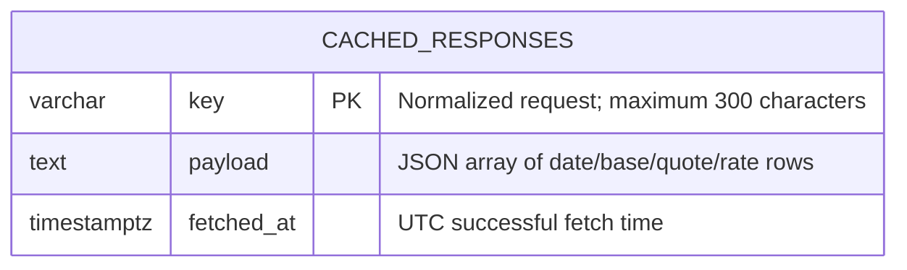

# Architecture and design

## Architecture decision

Use a layered monolith: browser presentation, FastAPI HTTP endpoints, application service, provider adapter, and SQL repository. A single process is simple to develop and deploy for a student project. Dependency injection through `create_app(database_url, provider)` makes the application testable without a real network or a shared production database.

The UI and API share an origin. No CORS wildcard or browser-held provider key is required. The database contains shared provider responses, not user identities or conversion histories. Watchlists stay in localStorage on the visitor's browser. Cross-device accounts are deliberately outside scope.



## UML model set

### Use cases



This use-case view uses Mermaid flowchart notation for compatibility. The named actors and use-case boundaries are the UML concepts; it is not a claim that Mermaid implements the full UML metamodel.

### Class diagram



### Sequence: conversion



### Activity: history and export



## Database design

The data model is intentionally small: one persisted response cache. No artificial user or payment tables are included. A response is keyed by the normalized base, sorted quote codes, and optional date range. Its JSON payload stores validated observations. This avoids confusing provider observation dates with cache retrieval times.



PostgreSQL schema is in `schema.sql`. SQLite uses the same SQLAlchemy model, with timezone normalization when values are read. `Base.metadata.create_all` is sufficient for this initial table; use a migration tool for future schema changes. Add cache cleanup and storage quotas before supporting arbitrary high-volume public queries.

## Design patterns and SOLID

**Adapter:** `FrankfurterProvider` converts upstream HTTP data into a stable internal record format and raises `ProviderError`. Changing provider need not change conversion or UI logic.

**Repository:** `RateRepository` owns SQL queries and persistence. `RateService` only calls `get` and `put`; it does not create SQL statements.

**Dependency injection:** The application factory accepts a provider and database URL. Tests inject `FakeProvider` and a temporary database.

**Single responsibility:** The service owns conversion/cache decisions, the adapter owns upstream validation, and the repository owns persistence. **Open/closed and dependency inversion:** a provider with the same `fetch` contract can be substituted without rewriting the service. The `RateProvider` Protocol documents the narrow contract. The current service accepts a repository by behavior; a formal repository Protocol could be added as the project grows.

## Wireframes

```text
DESKTOP
+------------+---------------------------------------------------+
| Crossrate  | Workspace / Overview             theme  initials  |
| Overview   +---------------------------------------------------+
| Converter  | Heading / source status / refresh                 |
| History    | [NGN rate] [EUR rate] [GBP rate] [GHS rate]         |
| Watchlist  | +----------------+ +----------------------------+ |
|            | | Amount         | | Pair / range / CSV          | |
| SP-050     | | From / To      | | Chart + exact-data table    | |
|            | | Convert/result | | Source and dates           | |
|            | +----------------+ +----------------------------+ |
|            | Watchlist / add / remove                          |
+------------+---------------------------------------------------+

MOBILE
+--------------------------------+
| Brand / icon navigation        |
| Heading / refresh / status     |
| [rate card] [rate card]         |
| [rate card] [rate card]         |
| Converter                      |
| History / chart / table / CSV  |
| Watchlist                      |
| Source / footer                |
+--------------------------------+
```

## Deployment model

Browser → HTTPS reverse proxy → Uvicorn/FastAPI → PostgreSQL and outbound HTTPS to Frankfurter. The supplied Compose setup is a local test configuration. Before public deployment: configure HTTPS, proxy request limits, database backups, retention, monitoring and dependency audits. GitHub Pages cannot execute this Python backend; do not upload only the HTML and claim the full application is hosted.
